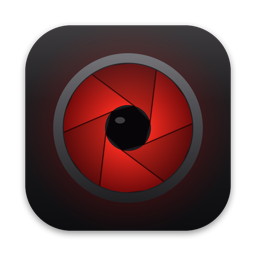

<p align="center">
  
</p>

<h1 align="center">DarkRoom</h1>

<p align="center">
  <b>A native Mac app for your <a href="https://immich.app">Immich</a> photo library, with Lightroom-style culling and editing.</b>
</p>

<p align="center">
  <a href="https://github.com/pingpongshow/darkroom/releases/latest"></a>
  
  
  
  
</p>

---

DarkRoom brings your self-hosted Immich library to the Mac as a fast, keyboard-driven app. You can browse
everything, cull and organise, edit RAW files and photos, and import from any disk. It talks to a **stock Immich
server through its public API**: nothing on the server is modified or replaced, and Immich web and the phone apps
keep working exactly as before and see every change instantly.

## Download

**[Download the latest version](https://github.com/pingpongshow/darkroom/releases/latest)**: open the DMG and drag
DarkRoom to Applications. Builds are signed with a Developer ID and notarized by Apple, and DarkRoom updates itself
(DarkRoom ▸ Check for Updates…).

**Requirements**

- A Mac with Apple silicon running macOS 26 or later
- An [Immich](https://immich.app) server and an account on it (tested with Immich v3.3)

## Features

### Browse

- Fast photo grid with a date bar beside it: click a year or month to jump there, and hover to see the full date
- Single-photo view with zoom, HDR display, Live Photos (click to play) and video; move between items with
  ‹ ›, the arrow keys or a two-finger swipe
- Search by description ("dog on the beach"), people, places, camera, lens, dates, type and rating
- Explore, People, Places, a world map, albums, shared albums, partner sharing and Memories
- Info panel with a histogram, camera details, the people in the photo, and the date and location as links
  that open their editors
- Changes made on phones or in Immich web appear immediately

### Cull and organise

- Rate 0–5, favourite (H), and pick / reject / unflag (P / X / U), with optional auto-advance
- Compare (C) and Survey (N) modes, a filter bar, and *Trash all rejects*
- Albums, tags, stacks, archive, locked folder, duplicates, bursts, large files
- Change dates, times and locations. They are written into the files as well, so the change travels with the photo
- Undo (⌘Z) for organising actions. Deleting always goes to Immich's trash first

### Edit

- RAW processing, white balance, tone, presence, tone curve, colour mixer, colour grading, detail and effects
- Crop, rotate, flip and straighten; lens corrections; perspective with Upright; camera calibration
- Masks (brush, linear and radial gradients, subject, sky, colour and luminance range) and heal / clone
- Presets with hover preview and an Amount slider; imports Lightroom `.xmp` presets and `.cube` LUTs
- Merge to HDR and panorama, lossless video rotation, and *Make Still* for Live Photos
- **Save / Cancel / Reset**, and DarkRoom always asks before you leave the editor with unsaved changes
- **Non-destructive**: an edit is saved as a new version stacked on top of the untouched original (which is hidden,
  so nothing appears twice). Reopen it later with every slider where you left it, or revert to the original

### Work with other apps

- **Edit in…** Photoshop, Pixelmator Pro, Affinity Photo, darktable, RawTherapee, GIMP, Krita, Lightroom,
  Capture One, Preview and others. Save and close, and DarkRoom uploads the result as the edited version
- **Import** from any disk or card straight to Immich (⇧⌘I or drag and drop). It skips what's already
  uploaded, keeps Live Photos and RAW+JPEG pairs together, and runs a resumable background queue
- **Export** to JPEG, HEIC, PNG, TIFF or original, with size, quality, colour space, metadata, watermark and naming
  options, saved as presets
- Quick Look (⌘Y), Share, Shortcuts actions (Upload to Immich, Search Immich, Open Album) and a menu bar status item

### People and privacy

- Several people can use one Mac: each signs in to Immich once, then switches with their own DarkRoom PIN or Touch ID
- Locks automatically after inactivity or when the Mac sleeps
- **Read-only mode** for a first look at an existing library: DarkRoom refuses every change to Immich
- Talks only to your Immich server, Apple's map tiles and the update feed. Thumbnails and previews are cached in
  `~/Library/Caches/DarkRoom`, and that account's cache is cleared when you sign out

## Getting started

1. Open DarkRoom. It looks for Immich servers on your network; you can also type an address.
2. Sign in with your Immich email and password, then choose a 4–6 digit DarkRoom PIN.
3. Connecting an existing library for the first time? Turn on **Read-only** in Settings ▸ Accounts and look around.
4. Press **D** (or click **Edit**) on a photo to edit it, and **⌘/** to see every keyboard shortcut.

The full **[user guide](docs/UserGuide.md)** covers everything.

### Handy shortcuts

| Keys | Action |
|---|---|
| G / E | Grid / single photo |
| D | Edit the selected photo |
| ← → or two-finger swipe | Previous / next photo |
| Esc | Back (editor → photo → grid) |
| 0–5, H | Rate, favourite |
| P / X / U | Pick, reject, unflag |
| C / N | Compare / Survey |
| R, Q, M | Crop, heal, masks (in the editor) |
| ⌘S | Save edits |
| ⌘F | Search |
| ⇧⌘I / ⇧⌘E | Import / Export |
| ⌘/ | All shortcuts |

## How DarkRoom stays safe with your library

- **No server changes.** Only Immich's standard API is used. There is no plugin, database access or modified server.
- **Originals are kept.** Edits become separate versions. Rewriting a file's date or location keeps the previous
  file (hidden), so phones don't upload it again.
- **Deletes are recoverable.** Everything goes to Immich's trash; only *Empty Trash* deletes permanently, after you
  confirm.
- **Your files on disk are never changed** by Import.

## Building from source

```sh
brew install xcodegen
xcodegen generate                                   # creates DarkRoom.xcodeproj from project.yml
open DarkRoom.xcodeproj                             # build and run the DarkRoom scheme
(cd Packages/DarkRoomKit && swift test)             # unit tests (integration tests need a test server)
```

| Path | Contents |
|---|---|
| `App/` | The macOS app (SwiftUI + AppKit) |
| `Packages/DarkRoomKit/` | `ImmichAPI` (client generated from Immich's OpenAPI spec, media, live events) and `DarkRoomCore` (accounts, library, editing engine, versions, import, export) |
| `tools/generate-immich-api.py` | Regenerates the API client from an Immich release's OpenAPI spec |
| `TestServer/` | Docker Compose definition and seeding script for a disposable stock Immich test server |
| `scripts/` | Test runners, test-server tunnel, release script, secret guard |
| `docs/` | [User guide](docs/UserGuide.md), [release process](docs/Releasing.md), release notes |

The editing engine uses Core Image on Metal in a linear Display P3 working space, `CIRAWFilter` for RAW files and
Vision for subject, sky and horizon detection. Metadata is written with a bundled copy of
[ExifTool](https://exiftool.org).

Settings and credentials live only in the Keychain or in git-ignored files. `scripts/check-secrets.sh` blocks
personal data and secrets from being committed.

## Feedback

DarkRoom is a personal project. Bug reports and suggestions are welcome in
[Issues](https://github.com/pingpongshow/darkroom/issues).

DarkRoom is an independent project. It isn't affiliated with or endorsed by Immich.

## License

Copyright © 2026 pingpongshow. All rights reserved. The source is published to be read; released builds may be
downloaded and used free of charge for personal use. See [LICENSE](LICENSE). Third-party components keep their own
licenses: see [THIRD_PARTY_NOTICES.md](THIRD_PARTY_NOTICES.md).
